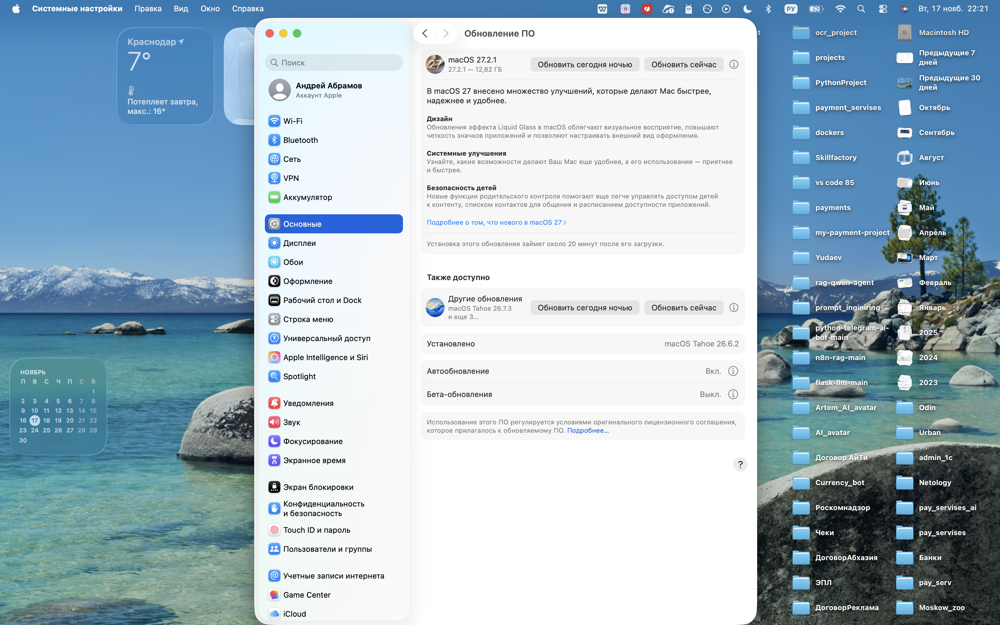
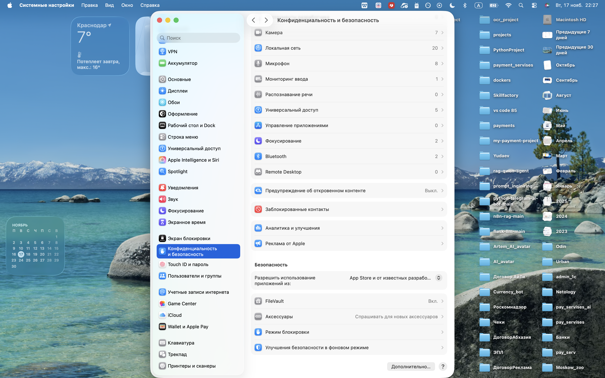
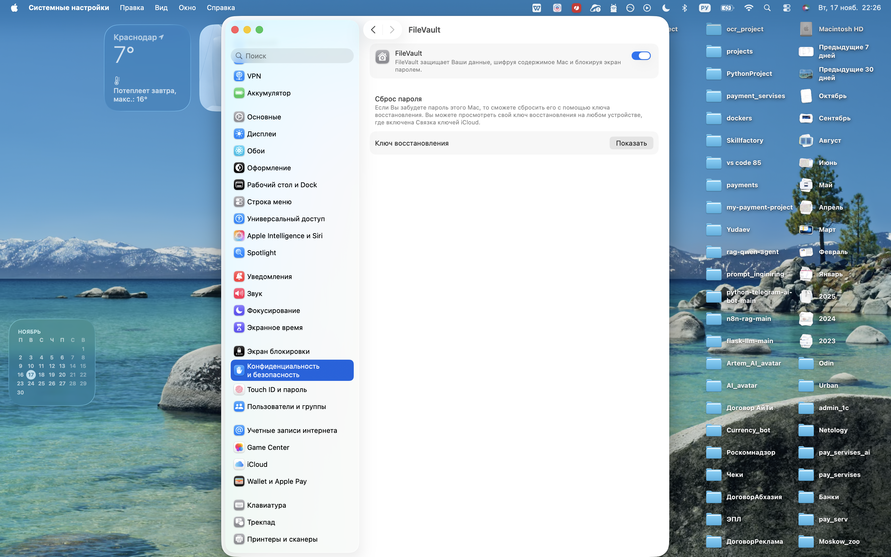
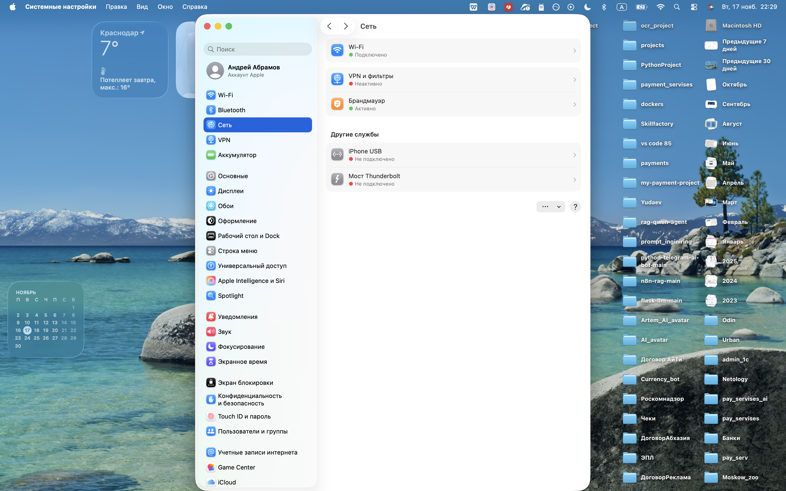
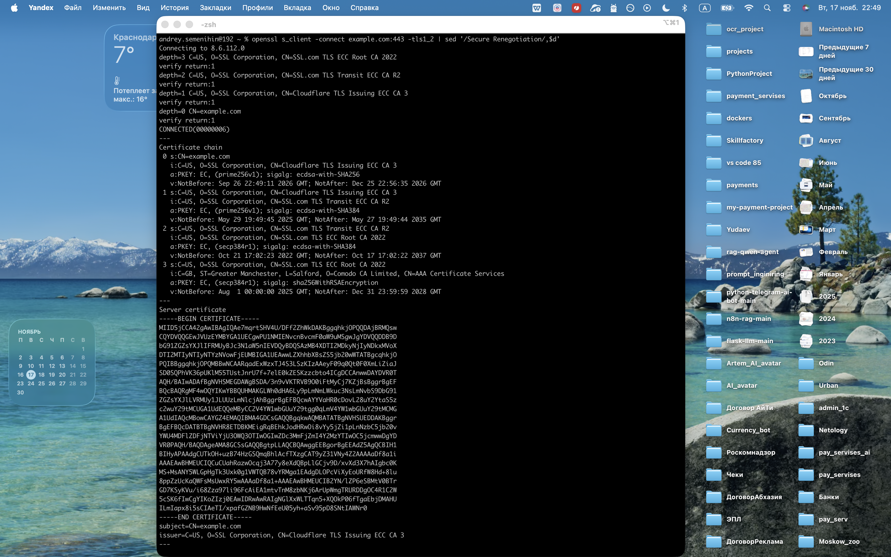
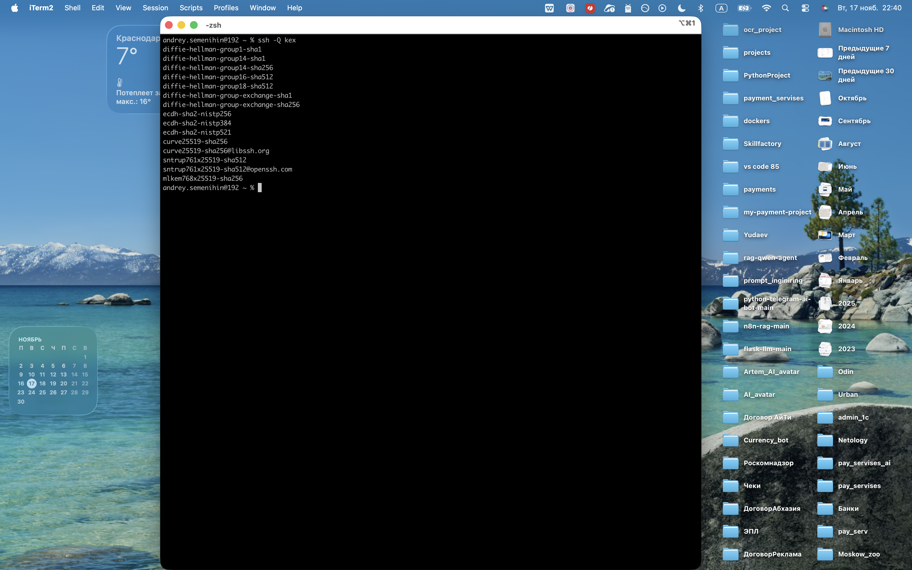

# Промежуточная аттестация по разделу 4

## «Защита информации на уровне пользователя и рабочей станции»

**Выполнил:** Семенихин Андрей Евгеньевич  
**Группа:** ИБ-6/2026  
**Дата выполнения:** 17.11.2026

---

## 1. Цель работы

Формирование практических навыков в области управления рисками информационной безопасности, анализа инцидентов ИБ и разработки мер по их предотвращению.

## 2. Задачи промежуточной аттестации

1. Анализ рисков информационной безопасности рабочей станции.
2. Создание политики безопасности.
3. Разработка плана реагирования на инциденты ИБ.
4. Проверка безопасности рабочей станции (анализ уязвимостей).

---

## 3. Решение

### Задача 1. Анализ рисков информационной безопасности

**Описание.** Я определил ключевые информационные активы рабочей станции, выявил для них потенциальные угрозы и уязвимости, оценил вероятность реализации и возможный ущерб, а также предложил меры снижения рисков. Оценка выполнена на основе отчёта по уязвимостям MaxPatrol (альтернативный вариант, допускаемый заданием: без установки лицензионного ПО для управления рисками).

**Ключевые активы рабочей станции:**

- документы (рабочие файлы, отчёты, договоры);
- учётные записи и пароли (локальные, корпоративные, к веб-сервисам);
- данные клиентов/контрагентов (персональные данные, коммерческая информация);
- почтовый клиент и переписка;
- браузер (сессии, сохранённые пароли, cookies);
- резервные копии.

**Таблица анализа рисков:**

| Актив                      | Угрозы / Уязвимости                                                                                    | Вероятность | Ущерб   | Меры снижения                                                                                                                              |
| -------------------------- | ------------------------------------------------------------------------------------------------------ | ----------- | ------- | ------------------------------------------------------------------------------------------------------------------------------------------ |
| Веб-сервер (порт 443/8080) | Sweet32 (CVE-2016-2183) — использование 3DES позволяет восстановить сессионные cookie через MITM-атаку | Высокая     | Высокий | Отключить поддержку 3DES в настройках TLS; использовать только AES-шифры; повторное сканирование                                           |
| Веб-сервер (порт 443/8080) | Некорректный сертификат (ID 7029) — самоподписанный, не соответствует домену                           | Средняя     | Средний | Заменить самоподписанный сертификат на официальный от проверенного центра сертификации                                                     |
| SSH-сервер (порт 22)       | Ненадёжные алгоритмы обмена ключами (ID 8369) — используются SHA1 и слабые эллиптические кривые        | Средняя     | Средний | Отключить старые и небезопасные методы обмена ключами и аутентификации; оставить только современные                                        |
| Рабочая станция (macOS)    | Неустановленные обновления ОС — известные уязвимости остаются не закрытыми                             | Высокая     | Высокий | Включить автоматические обновления; установить все критические патчи; регулярно проверять «Системные настройки → Основные → Обновление ПО» |
| Учётные записи и пароли    | Слабые пароли, повторное использование, хранение в открытом виде                                       | Средняя     | Высокий | Внедрить политику сложных паролей; использовать менеджер паролей; включить двухфакторную аутентификацию                                    |
| Антивирусная защита        | Устаревшие базы сигнатур, отключённая самозащита                                                       | Средняя     | Высокий | Обновлять базы сигнатур; включить самозащиту; контролировать статус антивируса                                                             |
| Документы и рабочие файлы  | Утечка через съёмные носители, облачные сервисы, потерю устройства                                     | Средняя     | Высокий | Ограничить использование съёмных носителей; шифровать конфиденциальные данные (FileVault); использовать DLP; регулярные резервные копии    |
| Почтовый клиент            | Фишинг, вредоносные вложения, спам                                                                     | Высокая     | Средний | Антиспам-фильтры; обучение сотрудников; блокировка подозрительных вложений; проверка ссылок                                                |

**Обоснование.** Оценка вероятности выполнена на основе общедоступной информации о распространённости эксплойтов для указанных уязвимостей. Ущерб определён с учётом возможных последствий: компрометация сессий и данных, простой, финансовые и репутационные потери. Предложенные меры направлены на устранение причин уязвимостей с минимальными затратами (изменение конфигураций, обновления, организационные меры). Рекомендуется провести повторное сканирование после применения мер.

---

### Задача 2. Политика безопасности

**Описание.** Я разработал структуру политики безопасности, применимой в организации и на уровне пользователя. В структуре выделены разделы: правила работы с конфиденциальной информацией, требования к парольной защите, управление доступом и антивирусная защита, ответственность сотрудников.

#### Раздел 1. Общие положения

1. Политика определяет правила работы с конфиденциальной информацией и обязательна для всех сотрудников.
2. Ответственный за реализацию политики — служба ИБ; контроль — руководители подразделений.
3. Политика пересматривается не реже одного раза в год и при изменении нормативных требований.

#### Раздел 2. Правила работы с конфиденциальной информацией

1. **Классификация и идентификация данных.** Определение того, какая информация относится к конфиденциальной (ПДн, коммерческая тайна, служебная информация).
2. **Правила доступа и авторизации.** Принцип минимальных привилегий: доступ предоставляется только тем сотрудникам, которым это необходимо для выполнения служебных обязанностей.
3. **Хранение и обработка информации.** Обязательная блокировка экрана при отлучке; запрет оставлять бумажные документы на столе; хранение конфиденциальных бумаг только в сейфах или запираемых шкафах; запрет передачи конфиденциальных данных по незащищённым каналам.

#### Раздел 3. Требования к парольной защите

Цель — недопущение утечки персональных данных, а также их несанкционированной модификации или уничтожения.

1. **Требования к паролям:** минимальная длина 12 символов; использование букв верхнего и нижнего регистра, цифр и специальных символов; запрет на словарные слова и персональные данные.
2. **Плановая и внеплановая смена паролей:** плановая — не реже одного раза в 90 дней; внеплановая — при подозрении на компрометацию, при увольнении сотрудника, при инциденте.
3. **Контроль:** служба ИБ проверяет соблюдение требований; при выявлении нарушений — блокировка учётной записи и уведомление руководителя; включена двухфакторная аутентификация для критичных сервисов.

#### Раздел 4. Управление доступом

1. **Идентификация и аутентификация:** каждый сотрудник имеет уникальную учётную запись; общие учётные записи запрещены.
2. **Разграничение прав:** доступ выдаётся по заявке руководителя; права пересматриваются при изменении должности и при увольнении.
3. **Принцип минимальных привилегий:** административные права предоставляются ограниченному кругу лиц; действия администраторов журналируются.

#### Раздел 5. Использование антивирусного ПО

1. На всех рабочих станциях и серверах обязательно установлено антивирусное ПО с актуальными базами сигнатур.
2. Запрещается отключать самозащиту антивируса и режим реального времени.
3. Обновление баз — автоматическое; контроль статуса — служба ИТ; при обнаружении вредоносного ПО — немедленное уведомление службы ИБ.

#### Раздел 6. Ответственность сотрудников

1. Сотрудники обязаны соблюдать политику и немедленно сообщать об инцидентах ИБ.
2. За нарушение требований предусмотрена дисциплинарная ответственность в соответствии с ТК РФ и внутренними регламентами.
3. Обучение по ИБ проводится при приёме на работу и периодически (не реже одного раза в год).

**Обоснование.** Использованы типовые разделы, соответствующие стандартам ИБ (ГОСТ Р ИСО/МЭК 27001-2021, требования ФСТЭК). Это обеспечивает полноту покрытия организационных (доступ, хранение, передача), технических (пароли, антивирус) и процедурных (действия при инцидентах) мер.

---

### Задача 3. План реагирования на инциденты ИБ

**Описание.** Я составил план реагирования на инциденты ИБ. Выделены четыре последовательных этапа: обнаружение, сдерживание, ликвидация и восстановление. На каждом этапе определены конкретные действия при обнаружении утечки данных или атаки.

**Этапы реагирования:**

1. Обнаружение — выявление факта инцидента и его признаков.
2. Сдерживание — локализация угрозы и предотвращение её распространения.
3. Ликвидация — устранение причины и источника угрозы.
4. Восстановление — возвращение систем в штатный режим работы.

**Действия на каждом этапе:**

**Обнаружение:**

- Мониторинг системных журналов и событий безопасности (SIEM, журналы ОС, приложений). На macOS — «Программы → Утилиты → Консоль» (Console.app), раздел «Журналы»; для сетевых событий — встроенный брандмауэр и сторонние SIEM-агенты.
- Анализ оповещений от антивируса, IDS/IPS и DLP-систем.
- Фиксация времени, источника и признаков инцидента.

**Сдерживание:**

- Изоляция заражённых систем (отключение от сети, сегментация). На macOS — отключить Wi-Fi/Ethernet в «Системные настройки → Сеть» или через `sudo ifconfig en0 down`.
- Блокировка скомпрометированных учётных записей и смена паролей.
- Ограничение распространения угрозы (отключение сервисов, изменение правил межсетевого экрана). На macOS — «Системные настройки → Сеть → Брандмауэр».

**Ликвидация:**

- Удаление вредоносного ПО, закрытие «закладок» и бэкдоров.
- Установка обновлений безопасности и исправление конфигураций. На macOS — «Системные настройки → Основные → Обновление ПО».
- Полная очистка заражённых систем (при необходимости — переустановка ОС).

**Восстановление:**

- Восстановление данных из проверенных резервных копий (Time Machine на macOS: «Системные настройки → Общие → Time Machine»).
- Проверка работоспособности систем и сервисов.
- Мониторинг восстановленных систем на предмет повторных атак.

**Обоснование.** План составлен на основе типовых рекомендаций по реагированию на инциденты (ГОСТ Р ИСО/МЭК 27035-2021, приказ ФСТЭК № 239) и покрывает полный цикл реагирования. Чёткое разделение этапов и конкретные действия позволяют системно подходить к любой атаке, быстро локализовать угрозу и минимизировать последствия.

---

### Задача 4. Уязвимости (аналитическая часть)

**Описание.** Я использовал альтернативный вариант, допускаемый заданием: без установки сканера безопасности. Выбрал не менее двух характерных уязвимостей из изученного материала раздела 4 и для каждой описал способ выявления и меры устранения. Дополнительно привёл уязвимости из отчёта MaxPatrol, чтобы показать связь с практикой. Проверка выполнялась на рабочей станции под управлением macOS.

**Таблица уязвимостей:**

| Уязвимость                                                                             | Способ выявления                                                                                                                                                                          | Способ устранения                                                                                                                        |
| -------------------------------------------------------------------------------------- | ----------------------------------------------------------------------------------------------------------------------------------------------------------------------------------------- | ---------------------------------------------------------------------------------------------------------------------------------------- |
| Неустановленные обновления ОС                                                          | «Системные настройки → Основные → Обновление ПО»; проверить наличие доступных обновлений и версию macOS                                                                                   | Установить все доступные обновления; включить автоматическое обновление                                                                  |
| Слабые пароли и повторное использование                                                | Проверить требования к паролям в политике; проанализировать учётные записи; использовать встроенные средства аудита; на macOS — «Системные настройки → Конфиденциальность и безопасность» | Внедрить политику сложных паролей; использовать менеджер паролей (Keychain Access); включить двухфакторную аутентификацию для Apple ID   |
| Устаревшие базы сигнатур антивируса / отключённая самозащита                           | Проверить дату обновления баз и статус самозащиты в консоли антивируса (если установлен); на macOS встроенная защита — XProtect и Gatekeeper                                              | Обновить базы; включить самозащиту и режим реального времени; проверить статус XProtect через `system_profiler SPInstallHistoryDataType` |
| Отключённый FileVault (шифрование диска)                                               | «Системные настройки → Конфиденциальность и безопасность → FileVault» — проверить статус                                                                                                  | Включить FileVault; сохранить ключ восстановления в безопасном месте                                                                     |
| Отключённый брандмауэр                                                                 | «Системные настройки → Сеть → Брандмауэр» — проверить статус                                                                                                                              | Включить брандмауэр; настроить правила для входящих соединений                                                                           |
| Sweet32 (CVE-2016-2183) — использование 3DES в TLS                                     | Сканирование уязвимостей (MaxPatrol); анализ конфигурации TLS; на macOS — `openssl s_client -connect host:443`                                                                            | Отключить поддержку 3DES в настройках TLS; использовать только AES-шифры; повторное сканирование                                         |
| Некорректный сертификат (ID 7029) — самоподписанный, не соответствует домену           | Сканирование уязвимостей; проверка сертификата в браузере или через `openssl s_client`                                                                                                    | Заменить самоподписанный сертификат на официальный от проверенного центра сертификации                                                   |
| Ненадёжные алгоритмы обмена ключами SSH (ID 8369) — SHA1 и слабые эллиптические кривые | Сканирование уязвимостей; анализ конфигурации SSH; на macOS — `ssh -Q kex` (список поддерживаемых алгоритмов)                                                                             | Отключить старые и небезопасные методы обмена ключами и аутентификации; оставить только современные                                      |

**Обоснование.** Выбранные уязвимости являются одними из самых частых причин инцидентов. Их выявление не требует специального ПО (кроме сканирования для сетевых уязвимостей), а устранение значительно повышает уровень безопасности без дополнительных затрат. Рекомендации основаны на данных отчёта MaxPatrol и официальных источниках (CVE, OpenSSL). Проверка на macOS выполнялась через встроенные средства: «Системные настройки», Терминал (`ssh -Q kex`, `openssl s_client`), Консоль.

---

## 4. Заключение / Выводы

В ходе выполнения задания я:

- определил ключевые активы рабочей станции и оценил риски с использованием таблицы «актив — угрозы/уязвимости — вероятность — ущерб — меры снижения»;
- разработал структуру политики безопасности с разделами о конфиденциальной информации, паролях, управлении доступом и антивирусной защите;
- составил план реагирования на инциденты ИБ по этапам «обнаружение → сдерживание → ликвидация → восстановление»;
- проанализировал характерные уязвимости и предложил способы их выявления и устранения (альтернативный вариант без установки сканера), проверив статус обновлений, защиты и конфигурации SSH на macOS.

Навыки: работа с моделью риск-ориентированного подхода, разработка организационных документов ИБ, планирование реагирования на инциденты, анализ уязвимостей. Сложности: ограниченность доступа к лицензионному ПО для управления рисками — решено альтернативным вариантом, допускаемым заданием.

---

## 5. Приложения

### Приложение А. Выдержка из отчёта по уязвимостям MaxPatrol

Параметры отчёта: тип данных «Уязвимость PenTest», исходные данные «По скану», достоверность «только высокая», 50 узлов, 1 скан.

### Приложение Б. Скриншоты проверки рабочей станции macOS

**Рисунок 1. Статус обновлений macOS**

_Подпись:_ «Системные настройки → Основные → Обновление ПО». На скриншоте виден статус проверки обновлений и версия macOS (macOS Tahoe 26.6.2), доступное обновление 27.2.1 и включённое автообновление.

**Рисунок 2. Статус защиты (FileVault)**

_Подпись:_ «Системные настройки → Конфиденциальность и безопасность → FileVault». На скриншоте видно, что FileVault включён (шифрование диска активно).

**Рисунок 3. Статус брандмауэра**

_Подпись:_ «Системные настройки → Сеть → Брандмауэр». На скриншоте видно, что брандмауэр активен.

**Рисунок 4. Проверка конфигурации TLS**

_Подпись:_ Вывод команды `openssl s_client -connect example.com:443 -tls1_2 | sed '/Secure Renegotiation/,$d'` в Терминале. Видно, что используется TLSv1.2 и современный шифр ECDHE-ECDSA-CHACHA20-POLY1305, проверка сертификата успешна (Verification: OK).

**Рисунок 5. Поддерживаемые алгоритмы обмена ключами SSH**

_Подпись:_ Вывод команды `ssh -Q kex` в Терминале. Виден список поддерживаемых алгоритмов обмена ключами, включая современные (curve25519-sha256, sntrup761x25519-sha512, mlkem768x25519-sha256).

### Приложение В. Таблица анализа рисков

Дублируется для наглядности (см. Задача 1).

### Приложение Г. Таблица уязвимостей

Дублируется для наглядности (см. Задача 4).

---

## Список источников

1. Федеральный закон от 27.07.2006 № 152-ФЗ «О персональных данных».
2. Постановление Правительства РФ от 01.11.2012 № 1119 «Об утверждении требований к защите персональных данных при их обработке в информационных системах персональных данных».
3. Приказ ФСТЭК России от 18.02.2013 № 21 (состав и содержание организационных и технических мер).
4. Приказ ФСТЭК России от 25.12.2017 № 239 (обеспечение безопасности значимых объектов КИИ).
5. ГОСТ Р ИСО/МЭК 27001-2021. Информационная безопасность, кибербезопасность и защита конфиденциальности. Системы менеджмента информационной безопасности.
6. ГОСТ Р ИСО/МЭК 27035-2021. Информационные технологии. Методы и средства обеспечения безопасности. Управление инцидентами информационной безопасности.
7. ГОСТ Р 57580.1-2017. Безопасность финансовых (банковских) операций. Защита информации финансовых организаций.
8. Методический документ ФСТЭК России «Методика оценки угроз безопасности информации» (утв. 05.02.2021).
9. Отчёт по уязвимостям MaxPatrol (файл «Отчет по уязвимостям1.pdf»).
